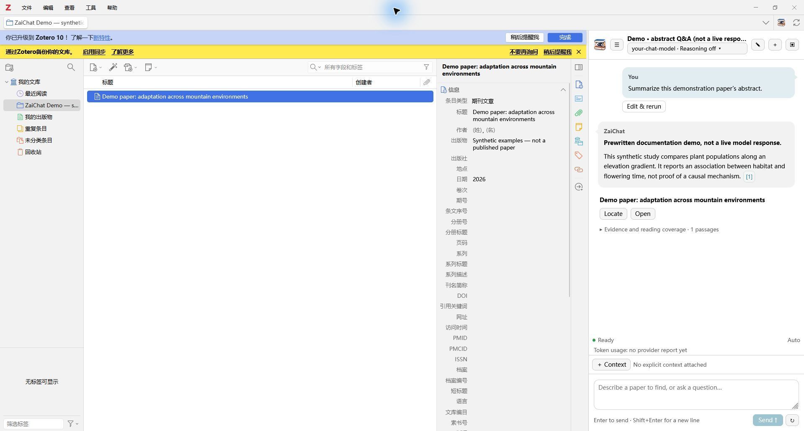
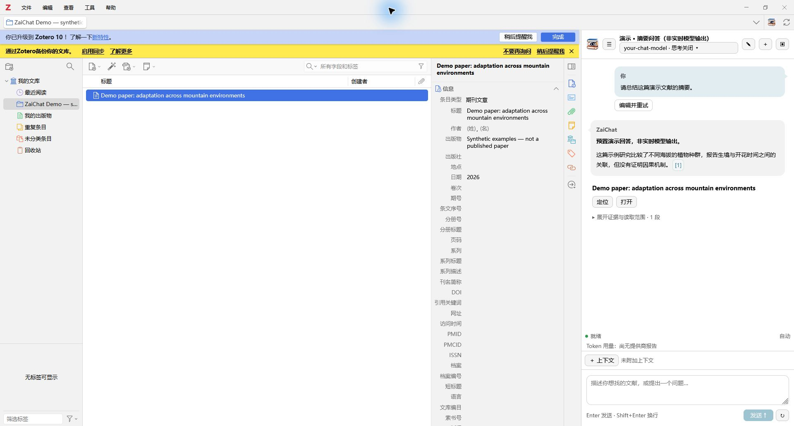
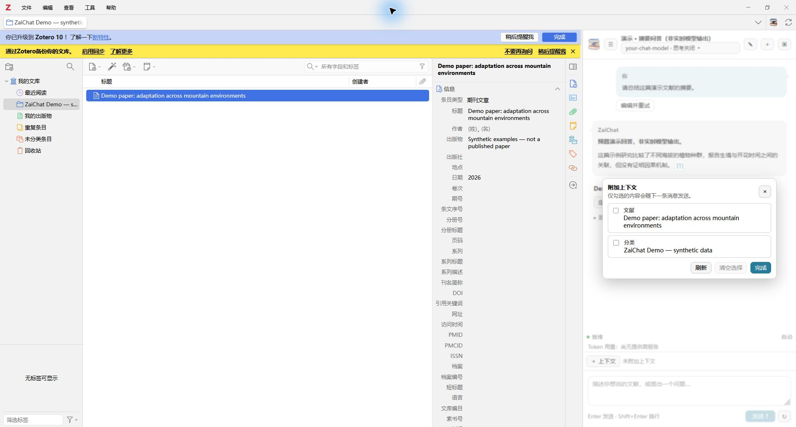

# ZaiChat

[English](README.en.md) | [简体中文](README.zh-CN.md)

A conversational assistant for your **local Zotero library**: find papers from
imperfect descriptions, ask evidence-grounded questions, compare abstracts, and
read selected passages without uploading your entire library.

**Current release: 0.8.0-beta.51 · Zotero 9–10.0 · Windows x64 CPU semantic runtime.**

[Download the XPI](https://github.com/booknary/zaichat/releases/download/v0.8.0-beta.51/zaichat-0.8.0-beta.51.xpi)
· [Release notes](https://github.com/booknary/zaichat/releases/tag/v0.8.0-beta.51)

## See it in Zotero



_Actual Zotero 10 screenshots with synthetic papers and an explicitly labeled,
prewritten demonstration conversation—not live model output. No private library,
API key, or real conversation is shown. The test Zotero shell uses Chinese while
the plugin's English and Chinese presentation is tested independently._



## What it does

- **Find remembered papers:** bilingual query planning, lexical and local semantic
  recall, candidate verification, and bounded indexed-fulltext evidence.
- **Read and compare:** selected paper abstracts, notes, annotations, and bounded
  attachment passages; multiple attachments including supplementary PDFs when their
  Zotero text caches are readable. Missing/partial indexes are disclosed.
- **Check sources:** inline citation buttons, one evidence group per paper,
  collapsed passages, collection-first Locate, and attachment opening.
- **Ask about RSS feeds:** read feed titles/abstracts directly, without adding feed
  entries to the personal-library semantic index. Date basis and coverage matter.
- **Choose context explicitly:** selected items/collections and available reader
  context are suggestions only; check them to include them in a request.
- **Manage conversations:** history, editing/rerunning, retry/stop, Markdown export
  with a save dialog, model/effort selection, and provider-reported token usage.
- **Approve limited writes:** create child notes, add tags, or relate papers. These
  require approval; undo is conflict-checked. No autonomous collection reorganization.
- **Choose sidebar or window:** switch display mode without discarding a draft.



## Install and configure

1. Download **`zaichat-0.8.0-beta.51.xpi`** from the Release. Do not install the
   automatically generated source-code ZIP as a plugin.
2. In Zotero, open **Tools → Plugins** (the wording may vary by locale), choose
   **Install Plugin From File…**, and select the XPI. Restart if Zotero requests it.
3. Open **Zotero Settings → ZaiChat**. Enter your OpenAI-compatible API base URL,
   API key and exact chat-model ID. Save the profile. “Fetch model list” can help
   select an ID; listing does not guarantee chat/tool support.
4. Open ZaiChat from its toolbar button, Tools menu, item context menu, or
   **Ctrl/Cmd+Shift+J**. A configured provider is needed for model answers.

This release supports Chat Completions and platform
profiles for DeepSeek, Volcano Ark, Bailian and OpenAI, including Responses routing
for OpenAI reasoning models. See [provider setup and limitations](docs/provider-compatibility.md).
Examples include compatible OpenAI/OpenRouter/DeepSeek endpoints and local
servers. Provider behavior varies; only use documented capabilities. Reasoning
levels follow plugin adapter rules, not the model-list endpoint. HTTPS is required
except for loopback local servers. Connection tests make small provider requests
and may incur charges. Downloads use TLS verification; no proxy bypass is applied.

Menus follow Zotero's language: Chinese for Chinese locales, English otherwise.
User messages, paper titles, evidence, prompts and search terminology are **not**
translated merely because the interface language changes. Technical diagnostics
may retain original provider/tool wording.

## Optional local semantic search

In **Settings → ZaiChat → Local semantic index**, enable semantic search, select a
model, then choose **Download, verify and select** and confirm the download.
The Windows x64 worker is bundled; **users do not install Python or start a server**.
Model files are downloaded separately from the pinned Hugging Face model versions
through **hf-mirror.com**, verified by size/SHA-256, and embedding-self-tested.
Restart after switching models. Build the initial index once; supported new/edited
paper metadata is synchronized automatically while enabled, with startup reconciliation.

| Model                 | Dimensions | Approx. download | Status                                                           |
| --------------------- | ---------: | ---------------: | ---------------------------------------------------------------- |
| multilingual-e5-small |        384 |          472 MiB | Recommended starting point                                       |
| multilingual-e5-base  |        768 |         1.05 GiB | Experimental; full-weight deployment regression pending          |
| multilingual-e5-large |       1024 |         2.10 GiB | Experimental; more RAM/disk/time; full-weight regression pending |

The settings show exact size/location, progress, pause/resume/cancel, rebuild and
clear actions. Extra temporary disk space and RAM are needed. Indexing covers
**title, abstract and tags**, not an embedding of every PDF/note/annotation. Each
model has its own index; switching does not delete previous models/indexes.

- Optional model storage can be outside the profile; restart after changing it.
- **Clear index** removes vectors, not the installed model.
- **Delete all semantic data** removes ZaiChat's managed runtime, models and index,
  not Zotero papers. Reinstall/download again before semantic use.
- Optional missing-abstract completion contacts OpenAlex using DOI, validates the
  title and stores the result in ZaiChat data, not Zotero's abstract field.
- No GPU mode. The bundled semantic runtime is Windows x64 only; macOS/Linux
  semantic deployment is not supported by this release.

## Privacy, limits and safety

“Local-first” does **not** mean model requests are offline. Your configured chat
provider receives questions, selected context and bounded candidate/evidence text.
API keys are stored in Zotero preferences, not an OS encrypted credential vault.
No key, personal conversations, index or model weights are distributed in the XPI.

Conversations live in `<Zotero profile>/zaichat/conversations/`; semantic data is
plugin-owned and separate from Zotero's internal database. Conversations are
retained until deleted. Diagnostics, exported Markdown and answers can contain
library content: inspect them before sharing. Full attachments/database files are
not uploaded wholesale. Model downloads contact the mirror; optional abstract
completion contacts OpenAlex. No web-literature discovery is provided.

Answers are fallible. Citation/quote checks and conservative negative/causal
language guards are **not** a scientific fact checker. An unsuccessful bounded
search does not prove absence. Token totals include retained provider reports,
not every failed/unreported request and not a billing estimate. No automatic
classification, collection creation/reorganization or metadata editing is included.

## Development

Use Node.js 24 or a compatible supported Node version:

```sh
npm install
npm run lint:check
npm run typecheck
npm test
npm run build
```

For native tests, point `ZOTERO_PLUGIN_ZOTERO_BIN_PATH` to your Zotero executable
and run `npm run test:zotero`. Tests use `.scaffold/test/profile`, **not your real
profile**. The opt-in documentation fixture uses synthetic records and no API calls.
The source snapshot includes the pinned worker/license resources; the build checks
them before reuse. Do not substitute a different executable with the same name.
Rebuilding the worker is a separate, dependency-locked release-engineering task.
Build output is `.scaffold/build/zaichat-<version>.xpi`; versioned backups go to
`releases/`. Updates are manual in this release; no automatic-update feed is enabled.

Zotero 10.0.6 is the native validation target; Zotero 9 compatibility is retained
with fallback/unit coverage. Small's deployment and index foundation have existing
regression coverage; every model/provider/platform combination is not certified.

## License

Original ZaiChat code: [MIT](LICENSE). Bundled runtime dependencies retain their
own licenses/notices under `addon/content/runtime/licenses/` and
`THIRD_PARTY_NOTICES.txt`. Embedding weights are downloaded separately under their
upstream model terms. Obsidian Copilot and Beaver informed interaction/architecture
ideas; their AGPL source/assets are not included or relicensed as MIT.
