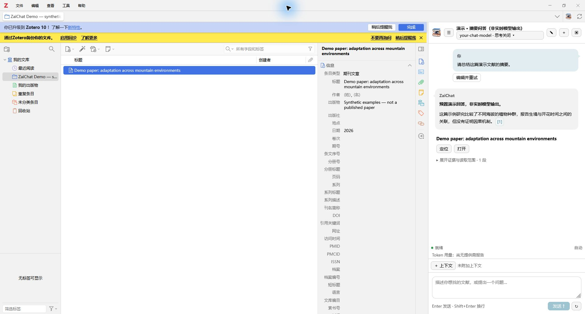
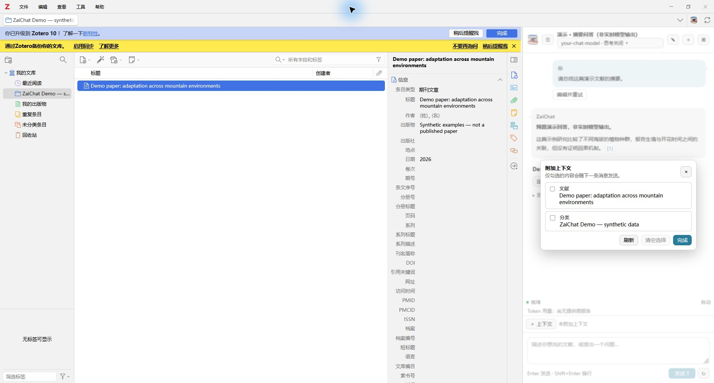
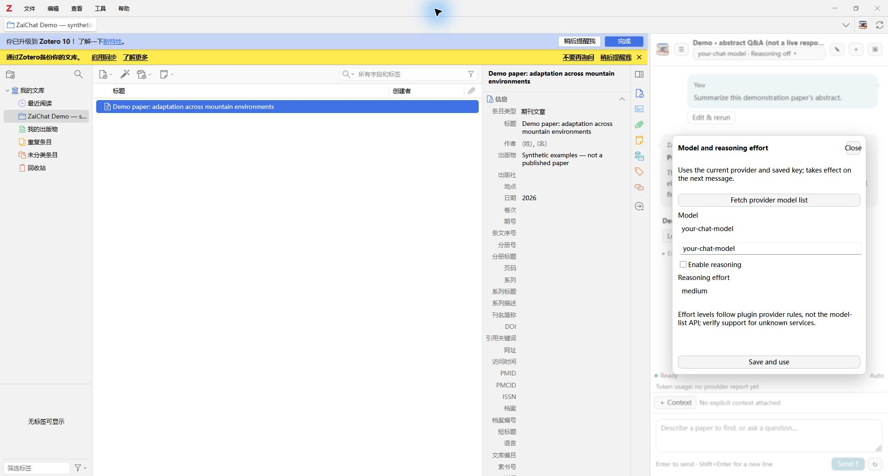
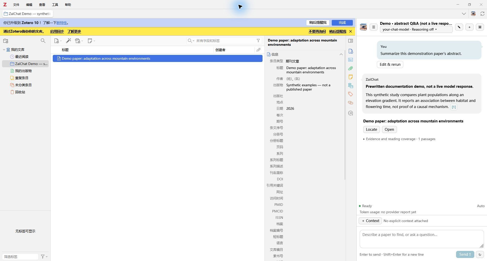

# ZaiChat

[English](README.md) | [简体中文](README.zh-CN.md)

面向 **Zotero 本地文库**的对话助手：根据模糊描述找文献、基于证据问答、比较摘要，
并有策略地读取原文片段，而不是把整个文库一次性上传给模型。

**当前版本：0.8.0-beta.46 · Zotero 9–10.0 · Windows x64 CPU 本地语义运行环境。**

[下载安装包](https://github.com/booknary/zaichat/releases/download/v0.8.0-beta.46/zaichat-0.8.0-beta.46.xpi)
· [发布说明](https://github.com/booknary/zaichat/releases/tag/v0.8.0-beta.46)

## 界面与功能



_截图来自真实 Zotero 10 和插件界面，使用合成文献及明确标注的预置演示对话，
不是实时模型输出；没有私人文库、真实会话或密钥。演示宿主 Zotero 使用中文，
插件的中英文显示在隔离测试中分别验证。_

- **模糊找文献**：双语关键词规划、词法与本地向量召回、候选核查和有界全文证据。
- **阅读与比较**：摘要、笔记、批注和附件片段；支持同一条目的多个可读附件，包括
  已被 Zotero 索引的补充 PDF。缺失、部分索引和未读取范围会明确显示。
- **可检查的来源**：行内引用跳转按钮，同一文献聚合证据、默认折叠，支持定位条目
  和打开附件。定位优先保留当前分类，其次其他归属分类，最后我的文库。
- **订阅问答**：直接读取 RSS 条目的标题与摘要，不将订阅条目加入个人文库向量索引。
  日期口径与实际读取范围会影响总结结果。
- **显式上下文**：选中文献、分类及可用的阅读器上下文只是候选，勾选后才随请求发送。
- **会话管理**：历史、编辑重跑、停止/重试、带路径选择的 Markdown 导出；聊天页
  可以切换模型和思考强度，并显示提供商实际报告的累计 token 用量。
- **审批写入**：仅支持创建子笔记、添加标签和 Related；需批准，撤销时检查冲突。
- **两种显示方式**：侧栏或独立窗口，切换时保留草稿。



## 安装和首次配置

1. 从 Release 下载 **`zaichat-0.8.0-beta.46.xpi`**。GitHub 自动生成的源码 ZIP 不是插件安装包。
2. Zotero 中打开 **工具 → 插件**，选择 **从文件安装插件…**，选中 XPI；按宿主提示重启。
3. 打开 **Zotero 设置 → ZaiChat**，填写兼容 OpenAI 的 API 地址、密钥和准确的对话模型名，
   保存配置。可用“获取模型列表”选择名称，但模型出现在列表里不代表支持聊天或工具调用。
4. 使用工具栏图标、工具菜单、条目右键菜单或 **Ctrl/Cmd+Shift+J** 打开聊天。

模型服务采用 `/chat/completions` 协议，不是 OpenAI Responses API。支持兼容的
OpenAI、OpenRouter、DeepSeek 端点及本地服务，实际能力以提供商为准。思考档位来自
插件适配规则，不是模型列表接口；未知服务需确认支持情况。远程地址必须 HTTPS，
仅回环本地服务允许 HTTP。“测试连接”会发送少量真实请求，可能产生费用。



菜单随 Zotero 语言切换：中文语言环境显示中文，其他语言回退英文。
**用户内容、论文标题、证据、提示词与检索词不会因界面语言切换而被改写。**
提供商错误和技术诊断可保留原始措辞。



## 可选：本地向量模型与索引

进入 **设置 → ZaiChat → 本地语义索引**，启用语义检索，选择模型，点击
**下载、校验并设置**并确认。Windows x64 运行环境随 XPI 提供，
**不需要用户安装 Python，也不需要手动启动服务。** 模型权重独立下载，
固定上游版本通过 **hf-mirror.com** 下载，经过大小、SHA-256 和向量自检。
切换模型后重启 Zotero。

| 模型                  | 维度 | 大致下载量 | 定位                               |
| --------------------- | ---: | ---------: | ---------------------------------- |
| multilingual-e5-small |  384 |    472 MiB | 推荐先使用                         |
| multilingual-e5-base  |  768 |   1.05 GiB | 测试选项，完整权重部署回归尚未完成 |
| multilingual-e5-large | 1024 |   2.10 GiB | 测试选项，需要更多内存、磁盘与时间 |

设置中显示实际大小和位置，提供进度、暂停/继续/取消、重建和清空操作。部署需额外临时
磁盘和内存。向量只索引**标题、摘要和标签**，不是所有 PDF、笔记与批注的全文向量化。
首次建立索引后，启用状态下新增/修改文献元数据会增量同步，启动时也会对账。

- 模型存储位置可设在配置目录外，修改后重启生效。
- **清空索引**只删向量，不删已安装模型。
- **删除全部语义数据**会删除 ZaiChat 管理的运行环境、模型和索引，不删除 Zotero 文献。
  再次使用语义检索前需重新部署。
- 切换模型建立独立索引，旧模型和索引不会自动删除。
- 可选摘要补全向 OpenAlex 发送 DOI，核对标题后存入插件语义数据，不写回 Zotero 摘要。
- 本版不支持 GPU；内置语义运行环境仅面向 Windows x64，未提供 macOS/Linux 部署。

## 隐私与边界

“本地优先”**不等于对话模型离线运行**。所配置的模型服务会收到问题、显式上下文、
候选元数据和有界证据。密钥保存在 Zotero 偏好中，并非操作系统加密密钥库。
XPI 不包含用户密钥、私人会话、向量索引或模型权重。

会话保存在 `<Zotero 配置目录>/zaichat/conversations/`，默认保留到用户删除。
语义数据库为插件独立数据，不直接改写 Zotero 内部数据库。导出的 Markdown、
诊断和回答可能包含文库内容，分享前请检查。不会整批上传完整附件或 Zotero 数据库。
模型下载访问镜像站，可选摘要补全访问 OpenAlex；不提供网络文献发现功能。

引用、原文匹配和否定/因果措辞检查**不等于科学事实核查**，回答仍可能出错。
有界检索未命中不能证明论文不存在。token 数值只累计保留的提供商用量报告，
不保证涵盖失败/未报告请求，也不等于账单。
**本版不含自动分类、创建/重组 Collection 或编辑文献元数据功能。**

## 开发与构建

使用 Node.js 24 或兼容版本：

Windows 克隆源码建议使用 `git -c core.longpaths=true clone https://github.com/booknary/zaichat.git`，
避免上游许可证长路径超限；这不会修改系统策略。

```sh
npm install
npm run lint:check
npm run typecheck
npm test
npm run build
```

原生测试设置 `ZOTERO_PLUGIN_ZOTERO_BIN_PATH` 为 Zotero 可执行文件路径，再运行
`npm run test:zotero`。测试使用 `.scaffold/test/profile`，不使用真实配置。
截图测试是显式启用的合成数据演示，不调用模型 API。
源码快照包含固定运行时和许可证，构建前校验，不依赖开发者机器上的 Python 环境。
不要用同名但不同内容的可执行文件替换它；重建 worker 属于单独的锁定依赖发布流程。
产物在 `.scaffold/build/zaichat-<版本>.xpi`，旧包备份在 `releases/`。
本版手动更新，不启用自动更新源。

本次原生验证环境为 Zotero 10.0.6；保留 Zotero 9 的兼容回退和单元测试。
不代表所有模型、提供商和平台组合均已认证。

## 许可证

原创代码采用 [MIT](LICENSE)。内置运行时依赖遵循各自许可证，见
`addon/content/runtime/licenses/` 和 `THIRD_PARTY_NOTICES.txt`；模型权重另行下载，
遵循上游条款。Obsidian Copilot、Beaver 仅提供交互与架构参考，未将其 AGPL 源码或素材
包含进本项目并改称 MIT。
